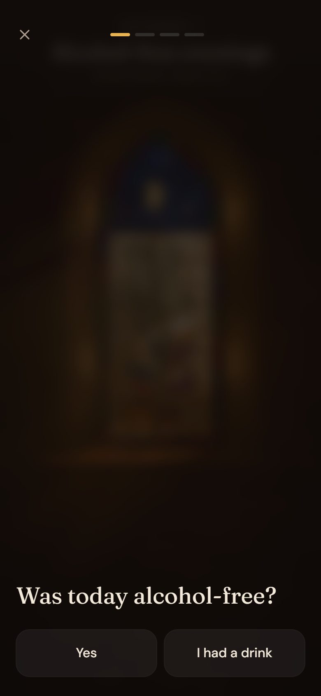
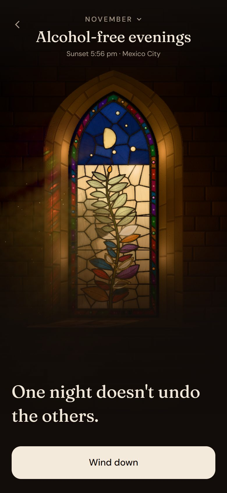
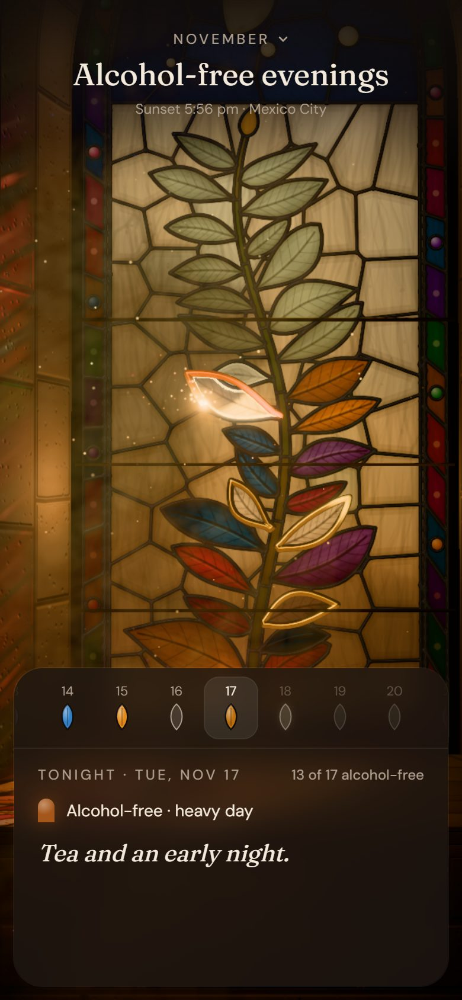
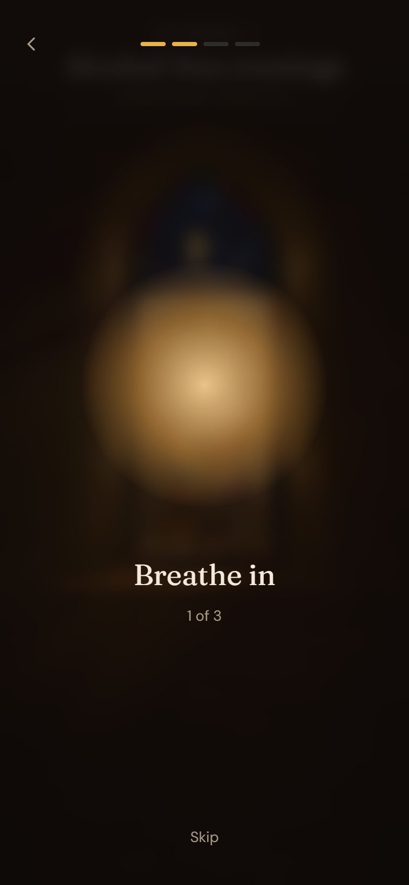
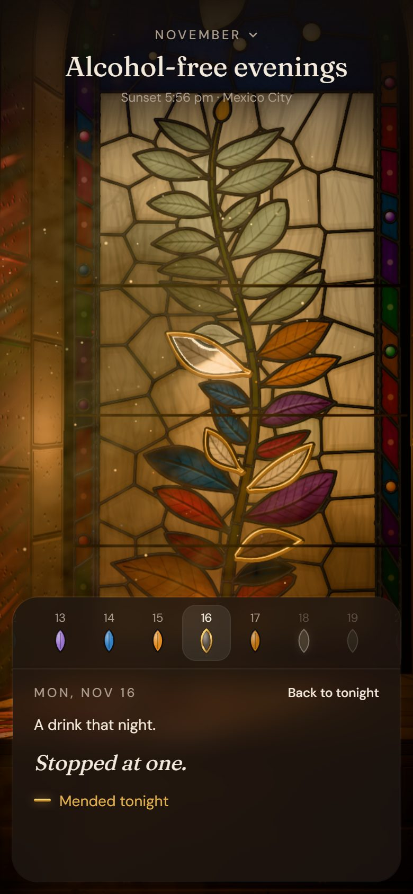
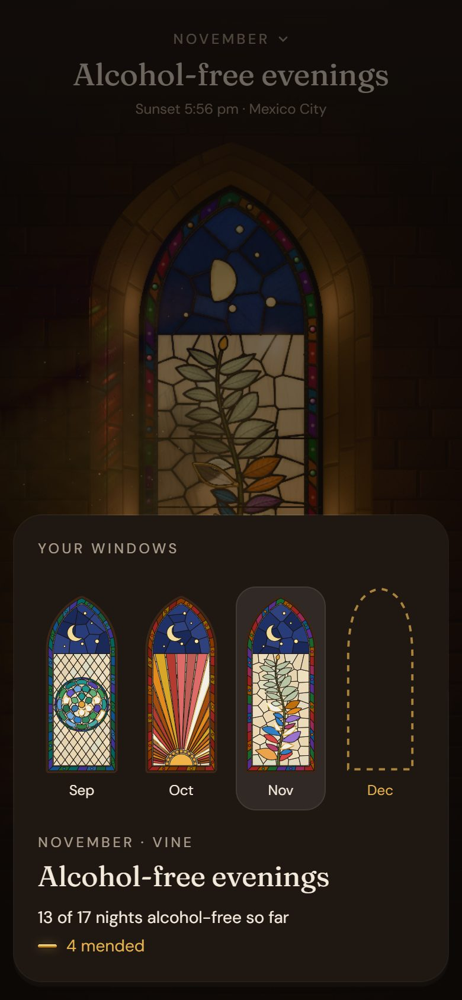
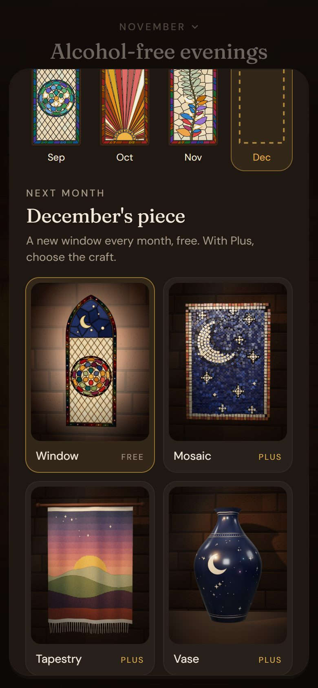

# Leadlight: alcohol-free evenings

Each alcohol-free night of the month sets one leaf of a stained-glass window. A night with a drink stays clear glass. The next alcohol-free night mends it: the lead around that clear leaf turns gold.

**Live:** https://horizon-takehome.vercel.app (open it on a phone) · **Run it:** `npm install && npm run dev`, then http://localhost:3000 at phone size.

<p>




</p>

**Contents:** [The brief, read as a business](#1-the-brief-read-as-a-business) · [What brings people back](#2-what-brings-people-back-and-how-each-one-fails) · [The bet](#3-the-bet) · [The concept](#4-the-concept) · [How I'd know it works](#5-how-id-know-it-works) · [The screen, step by step](#the-screen-step-by-step) · [Decisions](#decisions) · [Pricing](#pricing) · [Tonight's sky (REST)](#tonights-sky-three-public-rest-apis) · [Performance](#performance) · [Not built, written down](#not-built-written-down) · [Tools, AI included](#tools-ai-included) · [Where things live](#where-things-live) · [The original brief](#the-original-brief)

**Short on time?** Sections 1 to 5 are the whole case.

---

## 1. The brief, read as a business

**This app earns nothing until someone stays about three months.**

| Month | |
|---|---|
| 1 | Paying back what it cost to get them |
| 2 | Still paying back |
| 3 | Break-even |
| 4 | Profit |
| 5 | Where it really pays off |

So the daily screen has one job: give people something they'd miss if it disappeared. Not by nagging them.

## 2. What brings people back, and how each one fails

**Behavior first, product second.** Before choosing a habit or drawing a screen, I listed what actually brings people back to an app, with the evidence and the way each one fails. Only then did I pick the daily goal.

| What brings people back | For example | How it fails |
|---|---|---|
| A streak: days in a row | Duolingo's flame | One miss resets it to zero, and people quit |
| Something that grows as you use it | Forest's trees | The novelty fades once it's full, and every habit app has one |
| A surprise each time you open it | A new reward or quote every day | Feels manipulative if what's inside is thin |
| Being close to a goal | A progress bar at 90% | Stops working once the goal is reached |
| The moment feels good in itself | A calming ritual you'd do even without a reward | Only works if it's genuinely well made |
| Other people | Friends, a group, an accountability partner | Needs accounts and a backend |
| Identity: seeing yourself as someone who does this | "I'm someone who doesn't drink on weeknights" | Slow and abstract at first, but it gets stronger with time |

Ruled out early: putting money at stake (people stay out of fear, then cancel the day it costs them), and previews of a future, healthier you (day-to-day progress stays invisible).

Sources: commitment contracts (Giné, Karlan and Zinman 2010), the goal-gradient effect (people speed up as a goal gets close), the fresh-start effect (a new month or week restarts motivation), future-self research (Hershfield 2011) and identity-based motivation (Oyserman).

## 3. The bet

**People stay when the habit becomes part of who they are. Every night is evidence, not a score.**

| After 13 alcohol-free nights and one drink | A streak breaks | A record bends |
|---|---|---|
| What the app shows | 0 | 13 of 14 |
| What the person tells themselves | "I've blown it. Why bother?" | "I'm someone who's cutting back. I had one on Tuesday." |

The first drink after a run of alcohol-free nights is where people leave, so that's the moment the design has to handle best.

We learn who we are partly by watching what we do (Bem, self-perception theory). Research on drinking relapse calls the "I've blown it" spiral after one drink the abstinence violation effect (Marlatt and Gordon). The same model says what protects: the confidence that you can handle the next hard moment (coping self-efficacy, which Marlatt built on Bandura). The design uses both: the mend answers the slip, and the nightly note banks the confidence. The risks: identity is slow, so the first night already counts as evidence. It's abstract, so the evidence has to be visual. And it can get cheesy, so the app never tells you who you are. It shows you what you did.

Why it fits the business: a streak gets more fragile the longer it runs. A window gets more valuable. By month three you have three of them on a wall, with your own notes in them. That's what I'd expect people to miss.

## 4. The concept

**An evening check-in that builds a stained-glass window, one alcohol-free night at a time.**

| | |
|---|---|
| **Alcohol-free** | Colored glass in the color of how hard the day was: blue for easy, amber for normal, ruby for hard |
| **A drink, or no check-in** | Stays clear glass. Light still passes. A forgotten night can be filled in later |
| **Back** | The next alcohol-free night mends it: gold lead, soldered as you watch |
| **Monthly** | A new window every month, in a new design. The finished ones hang together on a wall |

Every evening, around the hour the drink used to come, the app asks one thing: was today alcohol-free? Then three slow breaths, paced on screen, "how hard was today?" (easy, normal or hard), and an optional one-line note, which turns the window into a diary in your own words. It asks as little as it can: there's nothing to tick off, and the breaths can be skipped.

**The night of a drink gets the most care,** because it's where people leave. The view pulls back to the whole month, every leaf before tonight still in color, and one line: "One night doesn't undo the others." Then the breaths and the note, as on any night. Nothing is said about gold or about tomorrow. The mend is found, not promised: the next alcohol-free night, its gold is soldered while you watch.

**Why alcohol.** It's Choose Your Horizon's own world, and it's where a slip costs the most. I first built this as a sleep wind-down, and the mend didn't mean much: missing three breaths before bed isn't a break. A drink on a night you'd decided not to have one is. Choose Your Horizon's members aim to drink less or to quit, and this version is for alcohol-free nights. For drinking less, the same window would take a nightly limit you choose (see [Not built](#not-built-written-down), 2).

This month's window happens to be a vine, but the plant isn't the mechanism. The record is. September's was a rose and October's a sunburst. Each month's window stays exactly as you left it: the nights with a drink clear, mended in gold.

**Inspiration.**

- **Kintsugi** (mending broken pottery with gold, so the repair shows) was the spark, and I'd rather say so. The version native to glass is the mending lead: old cathedral windows still show the extra strips of lead that held cracked panes.
- **Cathedral glass at dusk** for the look: warm, uneven, lit from behind. I wanted it to feel like sitting in a dim room, not like reading a chart.
- **Forest, Pikmin Bloom and Duolingo** as the safe answers I expected most entries to land near. They work, but what you collect is the app's (trees, flowers, a flame), not a record of your own nights, and it breaks on the first miss.
- **A psychologist friend** pressure-tested the idea, confirmed the core (a lapse should leave a mark you can recover from, never a reset) and pointed me to Nate Zinsser's E-S-P (a nightly note of one effort, one success and one bit of progress, from his work with West Point cadets), which became the three questions behind the nightly note.

## 5. How I'd know it works

**One number matters most: coming back after a drink.**

| | | |
|---|---|---|
| **Main metric** | Lapse recovery | Share of people with an alcohol-free night within two days of their first night with a drink. It measures the exact moment this bet is supposed to win. |
| **Honesty** | Drinks logged, not hidden | Nights checked in with a drink against nights with no check-in. If slips go unlogged, the design is making honesty feel expensive. |
| **Early hook** | Day 7 and day 30 return | Are people still checking in after the first week and month? |
| **Business** | Month-3 retention | Still subscribed at break-even, by signup cohort. |
| **A/B tests** | The mechanic and the comfort | A gold mend against a plain clear leaf, and "One night doesn't undo the others" after a drink against showing nothing, both judged on lapse recovery. |
| **On this screen** | Where people drop off | Each step, how many write the note (on alcohol-free nights and on nights with a drink), and how often they ask for another question. Writing a note is a stronger sign of ownership than a tap. |

---

## The screen, step by step

<p>


</p>

1. **Tonight.** The month's window, tonight's leaf breathing in it. Below, the month as a row you can tap, each night the same piece as in the window (a leaf this month, a petal in the rose, a ray in the sunburst), and a card with tonight's wind-down.
2. **Before tonight, if needed.** Nights from the last week with no check-in come first: "Fill in the ones you remember", with the same two answers for each, and an "Every night" row with those same two answers to fill them all at once, either way (each can still be changed after). Blanks stay as no check-in, and the step can be skipped. A single night can also be filled in later, from its card. A night filled in this way that mends the ones before it simply shows their gold, with no moment: that was days ago.
3. **Was today alcohol-free?** Two equal answers, "Yes" and "I had a drink", so the honest one is never the harder one to tap.
4. **After "I had a drink",** the dimming lifts: the whole month, every leaf before tonight still in color, and "One night doesn't undo the others." Then the breaths, as on any night.
5. **Three slow breaths,** paced on screen. They start by themselves, and "Skip" is always there.
6. **How hard was today?** One tap: easy, normal or hard, each shown in its own color of glass: blue, amber or ruby. The leaf takes that color, every night and every month, so a glance tells easy days from hard ones.
7. **A one-line note, if you want,** answering one question chosen by the night: "What went right today?"; after a drink, "What did you try today?" ("Stopped at one."); and on the night you come back, "What did you handle better than before?". "Another question" if it doesn't fit.
8. **Tonight's leaf is set.** The view moves in to it while it fills with color. Then the mend gets a moment of its own. The card steps away, and the view goes to each clear night tonight's leaf mended, in turn, oldest first: a hot point runs round the leaf, sparks fly, and the lead cools to gold behind it. Once the first gold is laid, one quote about falling and getting up, from a small hand-picked set, a different one each time: Hemingway's "strong at the broken places", Leonard Cohen's "There is a crack in everything. That's how the light gets in", Helen Keller, Oliver Goldsmith, Mary Anne Radmacher, a Japanese proverb. Each was checked against its source, wording and author. Then the slow way back to the whole month, and tomorrow's leaf starts to glow faintly.
9. **Any night, any time.** Tap a night in the row and the view moves in to its leaf. A night with a drink shows its note and the night that mended it, and its gold is soldered again.
10. **Your windows** (tap the month at the top). Every month's window on one wall, each in its own design, with the goal set for that month, its nights and how many were mended. Open one and the screen becomes that month, read-only: its window, its nights, its notes. "Back to tonight" returns.
11. **Next month's piece** is where the paid tier (Plus) goes: another window is free, and with Plus you choose the craft instead.

<p>


</p>

## Decisions

- **The name.** A leadlight is a window of small pieces of glass held in lead, and the lead is where the gold mend goes.
- **Nothing to tick off.** The leaf comes from the honest answer, not from finishing tasks. The wind-down is three breaths, and they can be skipped.
- **Forgetting isn't drinking.** A night nobody checked in on stays clear, as "no check-in", until it's filled in, for up to a week back. Past a week, memory is a guess, and an honest clear leaf is better. Filling one in is catching up, not coming back, so its gold appears quietly: the soldering is kept for tonight, the night you come back.
- **It runs on the real date.** The night turns at 4 am, so a check-in at 1 am counts for the night before. The sample month ends on the 16th (a night with a drink), so the nights after it start with no check-in, and the first alcohol-free check-in shows the mend.
- **Only an alcohol-free night mends,** and one is enough. The first day back is the hardest, so the reward can't be further away than that. A run of clear nights is mended together by that first night back.
- **A night with a drink is clear glass,** not a hole and not a reset: light still passes through it, and it keeps its note.
- **The mend is never announced.** It's found the next alcohol-free night. Promising it the night of a drink would turn comfort into a deal.
- **Words it never uses:** relapse, sober, fail, streak.
- **One question a night, no categories.** The questions come from E-S-P, but the app never names the framework or asks you to sort your day: it picks the question that fits the night. Your answers are a bank of proof of what you can do, in your own words.
- **Tapping a night in the row moves the view to its leaf,** so the row and the window read as one thing.
- **Tomorrow's leaf starts to glow faintly** once tonight is checked in, whatever the answer: a reason to come back, without a notification.
- **A wall, not a collection.** By month three you see three finished windows side by side, which is the point the business needs people to reach. Nothing is unlocked or earned: each window is just the record of its month.
- **The paid feature is choosing your craft** (see Pricing). The nightly check-in and your record are never behind the paywall: you pay for choice, never for your own evidence.
- **One small design system,** in `app/globals.css`. The colors are taken from the window at dusk (night, wood, lead, gold, ink, mist). Fraunces sets the questions, the goal, your notes and the quotes, and DM Sans everything else. Five shared shapes (card, eyebrow, two buttons, the gold came) are reused across the screens.
- **A reload starts the evening over,** so the check-in can be tried again down another path. Nothing is stored; a real app would keep the nights on the device. No backend, as the brief asks, and nothing about anyone's drinking leaves the phone.

## Pricing

The month is the unit of everything. Each piece (a window, or with Plus a mosaic, a tapestry or a vase) takes a month, and each month is a billing cycle, so the three cycles the business needs are three pieces on your wall.

- **Free:** the nightly check-in and wind-down, a new window design every month, chosen by us, and your whole record and wall, forever.
- **Plus (the subscription, monthly or yearly):** choose next month's craft: a **mosaic**, a **tapestry** or a **vase**, each built a little every night. In the app each is described only by what you'd expect. How it mends a night with a drink is a surprise you find the first time you come back, in its own tradition: a gold tile in the grout, a gap darned in gold thread (like Japanese boro mending), and for the vase, kintsugi. These are mocks: only the window is built.
- **When it's offered:** on the 1st, when a piece is finished and the next one starts. Never at night, never during the check-in.
- **Why the window is the free default and the vase isn't:** the vase's mend is kintsugi, the metaphor everyone knows. For some people it's poetic, so it's there to choose, but as the default it would feel borrowed. The mending lead is this app's own version of it.
- Prices would be a test, judged on month-3 retention, not a guess written here.

## Tonight's sky: three public REST APIs

The window shows tonight's real sky in your city, with no key, no signup and no location prompt: the city comes from the connection, checked against the phone's time zone.

| API | What it gives | Kept on the device for | If it fails |
|---|---|---|---|
| GeoJS | The city and its coordinates, from the connection, kept only if its time zone is the phone's (a VPN abroad isn't) | Half a day | Open-Meteo's geocoder takes the time zone's own city ("America/Mexico_City" is Mexico City): the right zone, maybe not the right city. If that fails too, nothing below runs and the window keeps its defaults |
| Open-Meteo forecast | Tonight's sunset, and the weather now | The day (sunset), 30 minutes (weather) | No sunset line, no weather on the glass |
| US Naval Observatory | The moon's phase tonight | The day | The window keeps its drawn crescent |

- **The moon in the window is tonight's moon,** redrawn as the lit part of its disc. **Rain leaves drops on the glass,** some still, some running down. **Clouds soften the light.**
- The forecast and the moon run **in parallel** under one time budget, starting as the page loads. Nothing waits for them.
- **For demos:** `?sky=rain`, `?sky=clear` and `?moon=0.9`. The code is in `lib/sky.ts`.

## Performance

Measured on the production build, as a mid-range phone (390×844 at 3×, the CPU slowed 4×), with the heavy steps named in the browser's performance timeline (`lib/perf.ts`).

| | Before | After |
|---|---|---|
| Main thread blocked after "Set tonight's leaf" | 1,000 ms | 0 ms |
| The screen responds to taps | 600 ms | about 400 ms |
| Longest freeze while loading | 1,550 ms | 700 to 900 ms, most of it the browser starting WebGL |
| Longest freeze while loading, desktop | 520 ms | under 200 ms |

- **Only what changed is redrawn.** Each window is cut and painted once, setting tonight repaints one leaf, and the shaders compile in the background before the first frame. The 3D code loads after the screen already responds.
- **Phones draw less** (lower resolution, 30 frames a second, nothing while the wind-down covers the window), a safety net lowers the resolution further if a device can't keep up, and without WebGL the page still works, with a flat window.

## Not built, written down

**Next, in this order**

1. **Support for when it's more than a slip.** Safety comes first. At sign-up, a short screening (AUDIT-C or similar) for heavy daily drinking, where stopping all at once can be medically dangerous: it points to a doctor, or to drinking less before stopping. On the night of a drink, a quiet "Need someone tonight?" under "One night doesn't undo the others", always in the same place, never a pop-up. When the pattern says so (several nights with a drink in a row, hard days piling up, check-ins that stop after a drink), a gentle question the next evening, with "Not now" as easy to tap as yes. One tap to a person you chose ahead of time, to a coach if the service has one, or to the helplines for your country. The rule: never scan what people write, always offer a way to a person. No alerts to anyone without consent, the diary stays on the device, and no chatbot playing therapist. The copy and the thresholds would be reviewed by a clinician.
2. **Drinking less, not only none.** Many of Choose Your Horizon's members want to drink less, not quit. A nightly limit they choose (two drinks, say): the question becomes "Did today stay within your limit?", nights within it are set in color, and a night over it stays clear until the next night within it mends it.
3. **"Having a craving?"**, my proposal for the live session. The drink happens at 7 pm, not at the 11 pm check-in, so this is a quiet line on the home card, never a notification. It opens urge surfing, Marlatt's own technique and the core of mindfulness-based relapse prevention (Bowen, Chawla and Marlatt; in a 2014 trial it cut drug use and heavy drinking at 12 months more than standard relapse prevention or usual care): the craving watched as a wave that rises and passes, with the breaths and the month's window as the anchor, then "Did it pass?". "Still here" offers more time, or "Need someone tonight?". It closes the circle on the same model: before the drink (the craving), the slip (the mend), and the confidence (the nightly note). It reuses the breaths, the window and the camera.

**Later**

4. **"What got in the way?"** as an option on the night someone comes back after a drink: a light version of how CBT looks at a lapse.
5. **Patterns,** from hard days and from cravings ("hard days cluster on Fridays", "the cravings come at 7 pm"), as a gentle way to spot triggers.
6. **The Plus crafts built for real** (mosaic, tapestry, vase); they're mocks for now.
7. **The month's colors** picked from the goal you set, or from your favorite color.
8. **The full year on the wall,** and a print of a finished window.

## Tools, AI included

The scaffold's stack (Next.js 16, React 19, Tailwind v4), three.js through React Three Fiber with postprocessing for the window, Open-Meteo and the US Naval Observatory for the sky.

AI: I built it with Claude Code. I set the direction, made the design calls and judged every version on a phone screenshot, and threw out a flat SVG window and a version that tilted with the mouse before this one. At one point two sessions worked in parallel on the same repo (one on the window scene, one on the flow and the UI), each committing only its own files. Every change was checked with Playwright screenshots at phone size, and the performance work was measured on the production build before and after each change, not guessed at.

## Where things live

<details>
<summary>The code, for building on it together</summary>

- `app/page.tsx` loads the month and renders `components/Moment.tsx`, which holds the screen's state.
- `components/MonthStrip.tsx` is the row of nights, `components/NightCard.tsx` the card under it, `components/Ritual.tsx` tonight's check-in and wind-down, `components/Windows.tsx` the wall of windows and where Plus goes.
- `components/WindowScene.tsx` puts the 3D window together from `components/window/`: the glass (`Glass`), the sun through it (`sun`), the light shafts and dust (`Air`), the stone (`Wall`), the camera and pacing (`frame`), the textures (`textures`). Without WebGL, `components/FlatWindow.tsx` draws it flat.
- `lib/window-model.ts` decides what each piece of glass means. `lib/designs.ts` cuts the month's window in its design (Rose, Sunburst, or the Vine in `lib/vine.ts`, which also cuts the frame they share). `lib/paint.ts` paints it.
- `lib/sky.ts` asks the APIs, `lib/tonight.ts` keeps this visit's check-ins and knows tonight's date, `lib/data.ts` types the month.
- `data/sample.json` is this month and the two before it. Colors and the UI's few shapes (`card`, `eyebrow`, `btn`) are tokens in `app/globals.css`.

Handy in the live session: a reload starts the evening over, `?sky=rain` and `?moon=0.15` change the sky, `?design=rose` or `?design=sunburst` shows this month in another design.

</details>

---

## The original brief

<details>
<summary>Design Engineer take-home (the scaffold's README)</summary>


# Design Engineer take-home

Thanks for making it this far. This is the part we care about most, and it's small
on purpose. Everything you need is right here in this repo, and your work stays
yours.

## What to build

The main daily moment of an app that helps someone stick with one daily goal. That's
the screen where they do the thing each day, mark it done, and get a little sense of
progress that makes them want to come back tomorrow. Just that one screen. You don't
need to build the rest of the app.

You pick the goal: learning a language, saving money, winding down for sleep, a small
creative habit, whatever you like. We want to see what you choose and why.

Build it in `app/page.tsx`. Design for a phone first, since that's how we'll look at
it. Making it responsive for desktop too is up to you.

## The thing I really want you to get

This kind of app only makes money as a subscription, and we don't make a cent until
someone sticks around for about three billing cycles (five is where it really pays
off). People don't stay because we nag them. They stay because they got hooked on one
thing early, something they'd miss if it disappeared.

So pick the one thing you think people would get hooked on, and build the daily moment
around it. Tell me where you're placing that bet.

## A few rules

- Start from this scaffold, don't rebuild it from scratch. We use the same starting
  point for everyone, and we'll build on your version together later, so keep it
  runnable.
- Data's up to you. There's a sample file at `data/sample.json` to use and reshape, or
  if it fits your idea, pull from a free external API (word of the day, quotes, FX rates,
  whatever). Showing some REST chops is a plus. Two rules either way: don't stand up your
  own backend, database, or auth, and keep it running for us out of the box, so nothing
  that needs an API key or a signup we'd have to create, and have it fall back gracefully
  if the API is slow or down. Interactions like checking a thing off or a streak ticking
  up can just live in local state.
- Plan for about 5 hours. Please don't go way over. If you've got bigger ideas, jot
  them down instead of building them.

Skip whatever doesn't matter here: no sign-in, no real payments (just show where a paid
feature would go), no empty states or edge cases. A small, clean, working thing beats a
big fragile one every time.

## Running it

```bash
npm install && npm run dev
```

It opens at http://localhost:3000 and reloads as you edit. Use Node 22 if you can
(there's an `.nvmrc`).

## Sending it back

Work in your own copy (clone it, or hit "Use this template"). Please don't push to this
repo or open a PR against it.

When you're done, email me at jamieson@chooseyourhorizon.com with either a zip of your
project (skip `node_modules`) or a link to your own repo. Make sure it still runs with
one command, since we'll build on it together in a short live session. Deploying it
somewhere like Vercel is optional, a nice bonus but we don't score it.

Send a quick note on your thinking too: what you looked at for inspiration, what you
chose and why, the one thing you're betting people get hooked on, and what you'd measure
or test to know it's working. A short write-up or a Loom under 5 minutes is perfect. And
tell me what tools you used, including AI. We use it, and using it well is a plus.

## How we'll look at it

Mostly the design: is it clear, nice to use on a phone, and does it actually make you
want to come back? We also care that it's built with some consistency instead of random
one-off styles, that your product bet makes sense, and that we can run it and follow
your thinking.

If anything's unclear, just email me before you start. Honestly, a good question counts
in your favor.

Have fun with it, and be creative. I'm excited to see what you come up with. And don't
skip the write-up, that's how I get a feel for the way you think.

Jamieson

</details>
