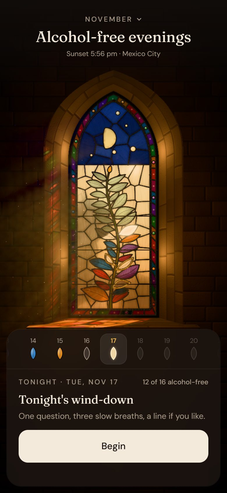
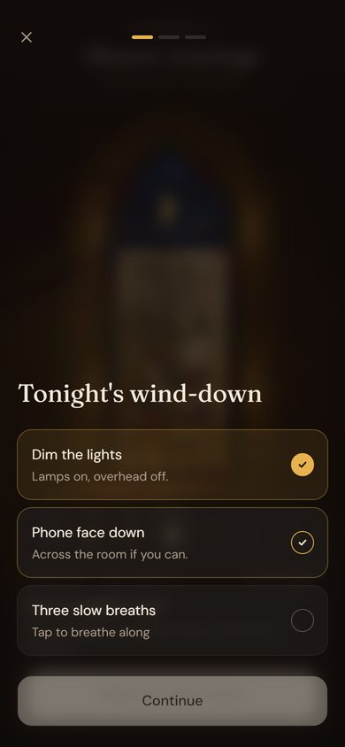
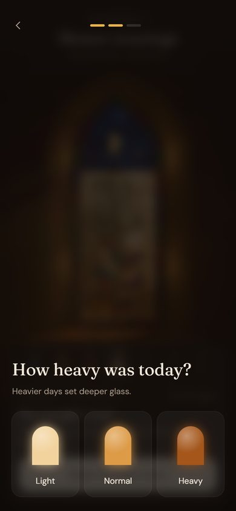
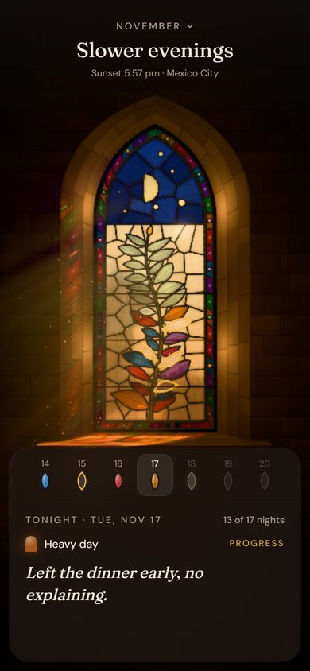
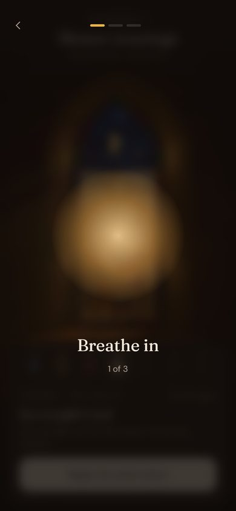
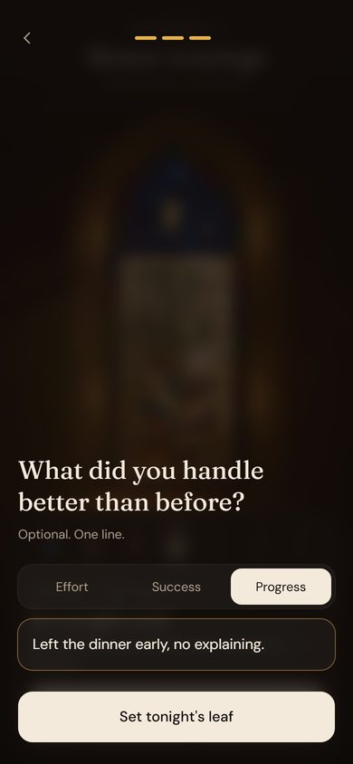
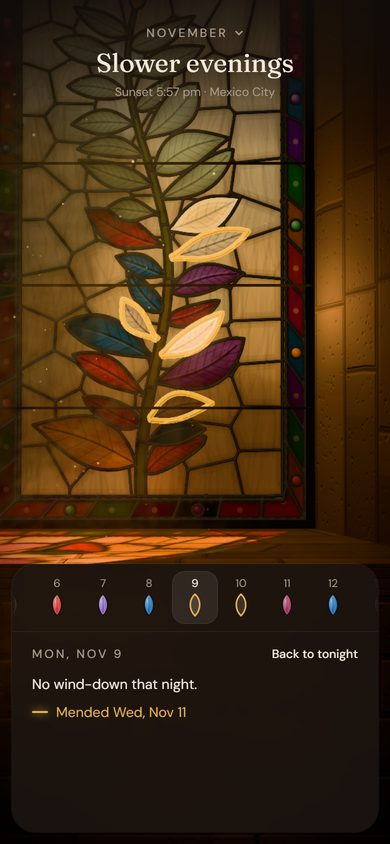
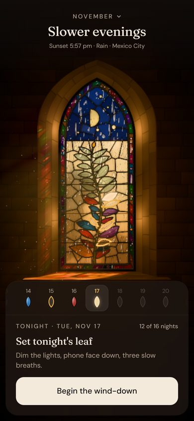
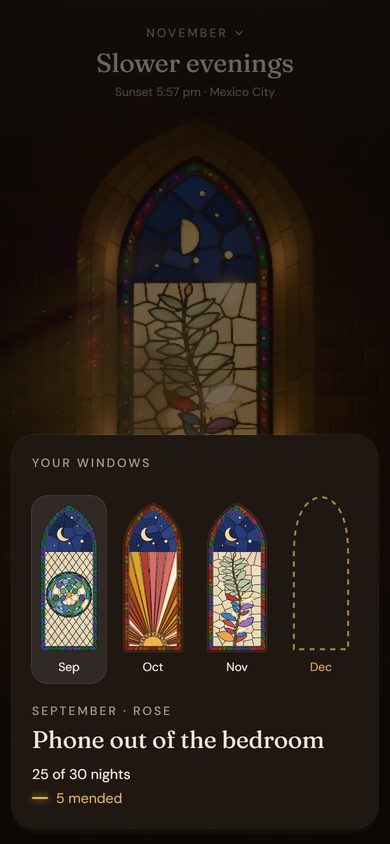
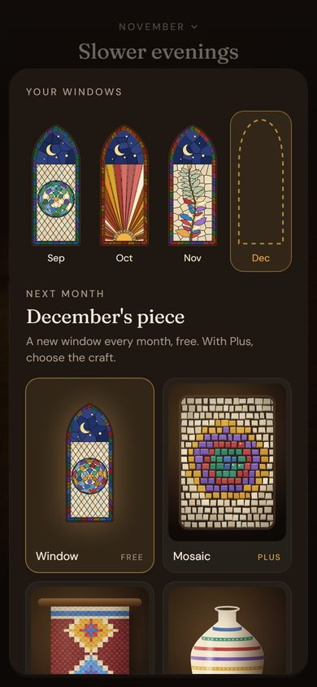

# Daily Moment: an evening wind-down

Each night of the month sets one leaf of a stained-glass window. Miss a night and its leaf stays clear glass. Come back and gold lead mends it.

**Live:** https://horizon-takehome.vercel.app (open it on a phone) · **Run it:** `npm install && npm run dev`, then http://localhost:3000 at phone size.

<p>




</p>

**Contents:** [The brief, read as a business](#1-the-brief-read-as-a-business) · [What brings people back](#2-what-brings-people-back-and-how-each-one-fails) · [The bet](#3-the-bet) · [The concept](#4-the-concept) · [How I'd know it works](#5-how-id-know-it-works) · [The screen, step by step](#the-screen-step-by-step) · [Decisions](#decisions) · [Tonight's sky (REST)](#tonights-sky-two-public-rest-apis) · [Performance](#performance) · [Not built, written down](#not-built-written-down) · [Tools, AI included](#tools-ai-included) · [Where things live](#where-things-live) · [The original brief](#the-original-brief)

The first five sections are the deck, slide by slide ([the slides](https://claude.ai/artifact/7GmmF1yVZMWkXMUAfoFPeU)).

---

## 1. The brief, read as a business

**This app earns nothing until someone stays about three months.**

| Month | |
|---|---|
| 1 | Paying back what it cost to get them |
| 2 | Still paying back |
| 3 | Break-even |
| 4 | Profit |
| 5 | Where it really pays off |

So the daily screen has one job: give people something they'd miss if it disappeared. Not by nagging them.

## 2. What brings people back, and how each one fails

**Behavior first, product second.** I stripped the psychology from the product first: what actually brings people back, with the evidence and the way each one fails. Only then did I pick the daily goal.

| Mechanism | How it fails |
|---|---|
| Streaks | One miss resets it, and people quit |
| Something that grows | Novelty fades once it's full (and everyone builds one) |
| A daily surprise | Feels manipulative if the content is thin |
| Almost there | Stops working once the goal is reached |
| The moment itself | Needs real craft to land |
| Social | Needs accounts and a backend |
| Identity | Slow and abstract, but gets stronger with time |

Ruled out early: money at stake (people stay out of fear, then cancel the day it costs them) and future-body previews (day-to-day progress stays invisible).

Sources I leaned on: loss aversion and commitment contracts (Giné, Karlan and Zinman 2010), the goal-gradient effect, the fresh-start effect, future-self research (Hershfield 2011) and identity-based motivation.

## 3. The bet

**People stay when the habit becomes part of who they are. Every night is evidence, not a score.**

| A score breaks | An identity bends |
|---|---|
| 14 → 0 | 13 of 14 |
| "I ruined my streak. Why bother?" | "I'm someone who shows up. I missed Tuesday." |

The first missed night is where people leave, so that's the moment the design has to handle best.

We learn who we are partly by watching what we do (Bem, self-perception theory). Relapse research calls the "I failed" spiral after a slip the abstinence violation effect (Marlatt and Gordon). The risks: identity is slow, so the first night already counts as evidence. It's abstract, so the evidence has to be visual. And it can get cheesy, so the app never tells you who you are. It shows you what you did.

Why it fits the business: a streak gets more fragile the longer it runs. A window gets more valuable. By month three you have three of them on a wall, with your own lines in them. That's what I'd expect people to miss.

## 4. The concept

**An evening wind-down that builds a stained-glass window, one night at a time.**

| | |
|---|---|
| **Done** | Colored glass, deeper on heavier days |
| **Missed** | Stays clear glass. Light still passes |
| **Back** | A gold mending lead around the gap |
| **Monthly** | A new window in a new design, its palette set by your intention. The finished ones hang together on a wall |

Tonight's leaf is already waiting, so there are no choices at bedtime. Each night takes three light steps: the ritual, "how heavy was today?", and an optional line, which turns the window into a diary in your own words. No emotional copy anywhere: the glass says the kind part.

This month's window happens to be a vine, but the plant isn't the mechanism. The record is. September's was a rose and October's a sunburst. Each month's window stays exactly as you left it: the missed nights clear, mended in gold.

**Inspiration.**

- **Kintsugi** was the spark, and I'd rather say so. The version native to glass is the mending lead: old cathedral windows still show the extra strips of lead that held cracked panes.
- **Cathedral glass at dusk** for the look: warm, uneven, lit from behind. I wanted it to feel like sitting in a dim room, not like reading a chart.
- **Forest, Pikmin Bloom and Duolingo** as the safe answers I expected most entries to land near. They work, but they reward the app's artifact, and they break when the streak breaks.
- **A psychologist friend** pressure-tested the idea, confirmed the core (a lapse should leave a mark you can recover from, never a reset) and pointed me to Nate Zinsser's E-S-P, which became the nightly line.

## 5. How I'd know it works

**One number matters most: coming back after a miss.**

| | | |
|---|---|---|
| **Main metric** | Lapse recovery | Share of people back within two days of their first missed night. It measures the exact moment this bet is supposed to win. |
| **Early hook** | Day 7 and day 30 return | Are people still opening it after the first week and month? |
| **Business** | Month-3 retention | Still subscribed at break-even, by signup cohort. |
| **A/B tests** | The mechanic and the framing | A gold mend against a plain gap, and "Wind down tonight" against "Be someone who winds down", both judged on lapse recovery. |
| **On this screen** | Where people drop off | Each of the three steps, how many leave a line, and which of E, S or P they pick. Writing a line is a stronger sign of ownership than a tap. |

Identity wording has strong lab results and mixed field replications, which is exactly why I'd test it instead of assuming it.

---

## The screen, step by step

<p>




</p>

1. **Tonight.** The month's window, tonight's leaf breathing in it. Below, the month as a row you can tap, each night the same piece as in the window (a leaf this month, a petal in the rose, a ray in the sunburst), and a card that says what tonight asks for.
2. **The wind-down.** Dim the lights, phone face down, three slow breaths. The breaths are paced on screen, because that's the step people skip when it's just a checkbox.
3. **How heavy was today?** One tap. Heavier days set deeper glass.
4. **One line, if you want.** An effort, a success or a bit of progress (Nate Zinsser's E-S-P), your pick.
5. **Tonight's leaf is set.** The view moves in to it while it fills with color, then steps back to the whole month. Tomorrow's leaf starts to wait, faintly.
6. **Any night, any time.** Tap a night in the row and the view moves in to its leaf. A missed night shows the night that mended it.
7. **Your windows** (tap the month at the top). Every month's window on one wall, each in its own design, with its intention, its nights and how many were mended. Open one and the screen becomes that month, read-only: its window, its nights, its lines. "Back to tonight" returns.
8. **Next month's window** is where Plus goes: a new window every month is free, choosing your own is Plus.

<p>


</p>

## Decisions

- **Tonight is preselected.** No choices at bedtime.
- **Heavier days set deeper glass.** Hard days count more, with no points.
- **No emotional copy.** The app never tells you who you are. It shows you what you did.
- **The line is E-S-P.** A bank of proof of what you can do (Bandura's self-efficacy), in your own words instead of an app's quotes.
- **The window comes to the night you open,** so the window and the row read as one thing.
- **Tomorrow's leaf waits too,** once tonight's is set: a reason to come back, with no words.
- **A wall, not a collection.** The month-three payoff made visible. Nothing is unlocked: every window is a record.
- **A new design every month** (Rose, Sunburst, Vine, then Nouveau): a fresh start on the 1st.
- **The paid feature is choosing your next window.** The house window is free, and the ritual and your record are never behind the paywall: you pay for choice, never for your own evidence.
- **Tonight is kept on the device,** so a reload shows it set. No backend, as the brief asks.

## Tonight's sky: two public REST APIs

The window shows tonight's real sky in your city, with no key, no signup and no location prompt: the city comes from the phone's time zone.

| API | What it gives | Kept on the device for | If it fails |
|---|---|---|---|
| Open-Meteo geocoding | The place, from the phone's time zone ("America/Mexico_City"), kept only if its time zone matches | Good | Nothing below runs, the window keeps its defaults |
| Open-Meteo forecast | Tonight's sunset, and the weather now | The day (sunset), 30 minutes (weather) | No sunset line, no weather on the glass |
| US Naval Observatory | The moon's phase tonight | The day | The window keeps its drawn crescent |

- **The moon in the window is tonight's moon,** redrawn as the lit part of its disc. **Rain leaves drops on the glass,** some still, some running down. **Clouds soften the light.**
- The forecast and the moon run **in parallel** under one time budget, starting as the page loads. Nothing waits for them.
- **For demos:** `?sky=rain`, `?sky=clear` and `?moon=0.9`. The code is in `lib/sky.ts`.

## Performance

Measured on the production build, as a mid-range phone (390×844 at 3×, the CPU slowed 4×), with the heavy steps named in the browser's performance timeline (`lib/perf.ts`).

| | Before | After |
|---|---|---|
| Main thread blocked after "Set tonight's leaf" | 1,000 ms | 0 ms |
| The screen responds to taps | 600 ms | about 400 ms |
| Longest freeze while loading | 1,550 ms | 700 to 900 ms, most of it the browser starting WebGL |
| Longest freeze while loading, desktop | 520 ms | under 200 ms |

- **Only what changed is redrawn.** Each window is cut and painted once, setting tonight repaints one leaf, and the shaders compile in the background before the first frame. The 3D code loads after the screen already responds.
- **Phones draw less** (lower resolution, 30 frames a second, nothing while the wind-down covers the window), a safety net lowers it further if a device can't keep up, and without WebGL the page still works, with a flat window.

## Not built, written down

- Your intention, or your favorite color, sets the month's palette.
- The full year on the wall, and a print of a finished window.
- Patterns from the heavy days ("heavy days cluster on Fridays"), as a gentle way to spot triggers.
- On the night someone comes back after a miss, an optional "what got in the way?", a light version of how CBT looks at a lapse.

## Tools, AI included

The scaffold's stack (Next.js 16, React 19, Tailwind v4), three.js through React Three Fiber with postprocessing for the window, Open-Meteo and the US Naval Observatory for the sky.

AI: Claude Code wrote most of the code with me. I set the direction and judged every version on a phone screenshot, and threw out a flat SVG window, a rose window and a version that tilted with the mouse before this one. At one point two sessions worked in parallel on the same repo (one on the window scene, one on the flow and the UI), each committing only its own files. Every change was checked with Playwright screenshots at phone size, and the performance work was measured on the production build before and after each change, not guessed at.

## Where things live

<details>
<summary>The code, for building on it together</summary>

- `app/page.tsx` loads the month and renders `components/Moment.tsx`, which holds the screen's state.
- `components/MonthStrip.tsx` is the row of nights, `components/NightCard.tsx` the card under it, `components/Ritual.tsx` tonight's three steps, `components/Windows.tsx` the wall of windows and where Plus goes.
- `components/WindowScene.tsx` puts the 3D window together from `components/window/`: the glass (`Glass`), the sun through it (`sun`), the light shafts and dust (`Air`), the stone (`Wall`), the camera and pacing (`frame`), the textures (`textures`). Without WebGL, `components/FlatWindow.tsx` draws it flat.
- `lib/window-model.ts` decides what each piece of glass means. `lib/designs.ts` cuts the month's window in its design (Rose, Sunburst, or the Vine in `lib/vine.ts`, which also cuts the frame they share). `lib/paint.ts` paints it.
- `lib/sky.ts` asks the APIs, `lib/tonight.ts` keeps tonight on the device, `lib/data.ts` types the month.
- `data/sample.json` is this month and the two before it. Colors and the UI's few shapes (`card`, `eyebrow`, `btn`) are tokens in `app/globals.css`.

Handy in the live session: `?fresh` starts tonight over, `?sky=rain` and `?moon=0.15` change the sky, `?design=rose` or `?design=sunburst` shows this month in another design.

</details>

---

## The original brief

<details>
<summary>Design Engineer take-home (the scaffold's README)</summary>


# Design Engineer take-home

Thanks for making it this far. This is the part we care about most, and it's small
on purpose. Everything you need is right here in this repo, and your work stays
yours.

## What to build

The main daily moment of an app that helps someone stick with one daily goal. That's
the screen where they do the thing each day, mark it done, and get a little sense of
progress that makes them want to come back tomorrow. Just that one screen. You don't
need to build the rest of the app.

You pick the goal: learning a language, saving money, winding down for sleep, a small
creative habit, whatever you like. We want to see what you choose and why.

Build it in `app/page.tsx`. Design for a phone first, since that's how we'll look at
it. Making it responsive for desktop too is up to you.

## The thing I really want you to get

This kind of app only makes money as a subscription, and we don't make a cent until
someone sticks around for about three billing cycles (five is where it really pays
off). People don't stay because we nag them. They stay because they got hooked on one
thing early, something they'd miss if it disappeared.

So pick the one thing you think people would get hooked on, and build the daily moment
around it. Tell me where you're placing that bet.

## A few rules

- Start from this scaffold, don't rebuild it from scratch. We use the same starting
  point for everyone, and we'll build on your version together later, so keep it
  runnable.
- Data's up to you. There's a sample file at `data/sample.json` to use and reshape, or
  if it fits your idea, pull from a free external API (word of the day, quotes, FX rates,
  whatever). Showing some REST chops is a plus. Two rules either way: don't stand up your
  own backend, database, or auth, and keep it running for us out of the box, so nothing
  that needs an API key or a signup we'd have to create, and have it fall back gracefully
  if the API is slow or down. Interactions like checking a thing off or a streak ticking
  up can just live in local state.
- Plan for about 5 hours. Please don't go way over. If you've got bigger ideas, jot
  them down instead of building them.

Skip whatever doesn't matter here: no sign-in, no real payments (just show where a paid
feature would go), no empty states or edge cases. A small, clean, working thing beats a
big fragile one every time.

## Running it

```bash
npm install && npm run dev
```

It opens at http://localhost:3000 and reloads as you edit. Use Node 22 if you can
(there's an `.nvmrc`).

## Sending it back

Work in your own copy (clone it, or hit "Use this template"). Please don't push to this
repo or open a PR against it.

When you're done, email me at jamieson@chooseyourhorizon.com with either a zip of your
project (skip `node_modules`) or a link to your own repo. Make sure it still runs with
one command, since we'll build on it together in a short live session. Deploying it
somewhere like Vercel is optional, a nice bonus but we don't score it.

Send a quick note on your thinking too: what you looked at for inspiration, what you
chose and why, the one thing you're betting people get hooked on, and what you'd measure
or test to know it's working. A short write-up or a Loom under 5 minutes is perfect. And
tell me what tools you used, including AI. We use it, and using it well is a plus.

## How we'll look at it

Mostly the design: is it clear, nice to use on a phone, and does it actually make you
want to come back? We also care that it's built with some consistency instead of random
one-off styles, that your product bet makes sense, and that we can run it and follow
your thinking.

If anything's unclear, just email me before you start. Honestly, a good question counts
in your favor.

Have fun with it, and be creative. I'm excited to see what you come up with. And don't
skip the write-up, that's how I get a feel for the way you think.

Jamieson

</details>
